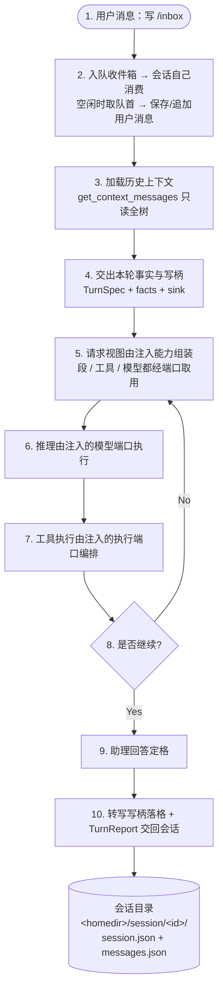

# Session Orchestration Architecture (会话编排架构说明书)

Session 插件是 Symbio 架构中的**会话持久化与生命周期中心**：持有事实源、转写与运行态，负责加载历史、**解析**系统提示词（收集各能力经提示词段行注册的段，本层不自己拼）、经 `Registry`（收集口，put/get/list 三方法）汇集工具与选项，并在**一轮的边界**上派发 / 等待 / 收尾（[D-086](../../docs/003-design/014-单环一表.md "DE-014-单环一表")）。一轮的执行本体由宿主经驱动端口注入：环按行还债、事实经 `Host.source` 落库；本插件只负责装配与收尾。模型服务经模型端口接入，本插件不持有其实现。

本文档只阐述本插件内的会话保存、事实落库与写入期裁剪规则，说明其具体规则、参数配置及 Rust 实现落点。

> **目标形状**见 [DE-001 §4.3 / §4.4](../../docs/003-design/001-核心架构.md "DE-001-核心架构")
> 与 [DE-051](../../docs/003-design/051-机制形状规格.md "DE-051-机制形状规格")。
> 本文只写**当前实现**，不复述目标裁决。

> **深度设计与专题文档**（核心循环收口、模块分工、历史审计、前端性能、VDFS 会话消息映射、级联选项……）
> 见 [`src/docs/`](src/docs/README.md "crates/symbio-plugin-session/src/docs/README")——本文只写**现行机制与配置面**，`src/docs/` 写**为什么这样设计**。

---

## 一、 系统架构数据流图 (Architecture & Data Flow)

下列架构图只标出**本插件的边界与交接面**：会话负责存储与生命周期，执行体由宿主注入，
其内部形状不在本插件文档中描述。



---

## 二、 核心参数与配置 Schema (Configuration Details)

会话与压缩系统的全部表现都由会话配置参数控制。配置落在**本插件自己的目录**：

```text
{homedir}/session/PLUGIN.yml 本插件的配置（可在 <根>/session/PLUGIN.yml 上编辑）
```

字段真源是本插件的 `config.rs::SessionConfig`（**定义由配置的拥有者产出**：设置页的表单定义从 `SessionConfig::default` 读出，不写第二份字面量，避免「面板显示值与实际行为漂移」）。

以下是**与本节机制直接相关的键**的示例（不是全表）：全字段真源见
`config.rs::SessionConfig`，配置面总表见 [`docs/004-ref/001-CONFIGURATION.md`](../../docs/004-ref/001-CONFIGURATION.md "RE-001-CONFIGURATION")。
（`classify_enabled` / `compose_enabled` / `progress_*` / `supplements_*` /
`conation_enabled` / `skill_compile_enabled` 等键不在下方示例中，
它们归「对话面机制」与「自主与学习」两节。）

```yaml
session:
 # 存储目录：本插件自己的目录（父插件经 PLUGIN_DIR 告知，装配态即 <homedir>/session/），
 # 跟随系统目录 (homedir) 切换，不作为配置项暴露。
 # 注：会话只有一种落盘布局，没有可切换的"存储后端"；也只有磁盘一种驻留
 # （无事实源的临时会话已退场，D-329），与用户配置无关。
 # 注：会话默认不绑定智能体（纯工具模式）。智能体选择属于前端会话级偏好，
 # 由 session.metadata.agent_id 按会话记录，后端不提供 default_agent。
 
 # 1. 存储级策略
 max_messages: 100 # 单会话本地保存的最大对话轮数限制 (以 User 消息计数；0 = 不限制，默认 100)
 
 # 2. 单轮迭代边界：v2 **没有**这一项配置（工具轮数不设上限，理由见三.2）
 
 # 3. 上下文窗口与压缩
 context_messages: 6 # 发送给 AI 的对话上下文滑动窗口轮数 (以 User 消息轮次对齐截取；也是存储期 prune 的保留分水岭)
 # 上下文压缩不在本插件配置里：入口由压缩债声明（产物 session.consolidated）
 
 # 4. 存储期工具链裁剪
 prune_tool_history: true # 是否在落库时物理裁剪 context_messages 分水岭之前的历史工具链（Tool/ToolCall/Reasoning 及其子节点；只删节点不删归档）
```

---

## 三、 五大核心策略的具体规则与 Rust 实现机制 (Implementation Strategies)

### 1. 单会话对话轮数上限存储策略 (`max_messages`)

> **目标**：防止单个会话历史由于对话轮数过多而无限膨胀，导致磁盘溢出或加载序列化变慢。

* **具体规则**：
 * 对每个 Active Session 物理存储的历史记录实施**最大保存对话轮数限制**。
 * `max_messages` 表示最大保存的对话轮数，每一轮以一个 `User` 消息起始；默认 `100`，`0` 表示不限制（历史上此处曾有 `.max(500)` 硬下限，导致设置面板中小于 500 的值静默失效，现已移除）。
 * 当存储的对话轮数超出阈值时，自动从会话开头执行 FIFO 裁剪，移除最老的多余对话轮次。**只删消息节点、不动 `tool_archives/` 存档文件**：存档落在会话数据目录，磁盘生命周期由 `tool` 插件的 L0 守卫按会话作用域滚动淘汰（`ARCHIVE_KEEP`，D-528），避免 `max_messages` 成为静默删文件的破坏性操作。
 * **智能对齐**：此策略确保物理保存下来的会话，其起始消息也总是以一个完整的 `User` 消息起始，从而绝对避免了历史反序列化对齐失败的问题。
* **Rust 实现策略**：
 * 在 `chat_session/write.rs` 的 `append_messages`（**存储写入边界**）中，扫描 `User` 消息索引并执行轮数对齐物理截断，确保物理存储也总是以 `User` 消息为开端：

 ```rust
 let max_turns = cfg.max_messages; // 0 = 不限制
 let mut user_indices = Vec::new;
 for (idx, msg) in session.messages.iter.enumerate {
 if msg.role == Some(NodeRole::User) {
 user_indices.push(idx);
 }
 }
 if max_turns > 0 && user_indices.len > max_turns {
 let start_idx = user_indices[user_indices.len - max_turns];
 session.messages.drain(0..start_idx); // 归档文件不在此处删除
 }
 ```

---

### 2. 单轮迭代边界（v2：不设工具轮数上限）

> **目标**：让自主 Agent 的多步决策由模型自己收束，主循环不设「跑了几轮就停」的旋钮。

* **现状规则**：
 * 一次用户 Prompt 触发一个请求；请求内部 `推理 -> 工具调用 -> 工具结果返回 -> 再推理` 的迭代在
 v2 运行器的环体里跑完（turn_runner.rs（B2 退场，[DE-048](../../docs/003-design/048-端口机制裁决.md "DE-048-端口机制裁决") 的 `D-318`） 的 2e/2f），**主循环侧看不见第几轮工具**。
 * 界只有三条：单条响应内的工具调用数上限 `MAX_TOOL_CALLS_PER_RESPONSE = 32`
 （模型端口执行体，超出的调用合成一条「本次调用未执行」的结果喂回模型，指引它
 把剩余调用放到下一轮）、用户中止、provider 断流。
 * 长度截断（`finish = Length`）由模型侧归一成 `ModelFinishReason::Length`，随结果以
 `truncated` / `reason` 上报（模型端口执行体）：收束判据据此区分
 「自然结束」与「被截断」，末轮答话在截断时取空。
 续写次数不是内核常量——它由上层按需再发一轮决定。
* **为什么这一层不设软上限**：主循环读不到工具轮数——工具在 v2 运行器的环体里一批批跑完
 （turn_runner.rs 于 B2 退场，[DE-048](../../docs/003-design/048-端口机制裁决.md "DE-048-端口机制裁决") 的 `D-318`），本轮请求侧只有一个
 「发过几次请求」的计数（续写才让它 >1）。一个判不到真实轮数的
 上限等于**没有上限**，却会让人以为设过：它与「默认不限制」逐字等价，配错与没配长得一样，
 没有任何信号能区分。真要这道上限，位置在 2e（结果接进 `exchange`）与 2f（轮内注入）之间，
 那里有真实的 `tool_round`；裁决与逐符号名册见
 [D-074](../../docs/003-design/014-单环一表.md "DE-014-单环一表")。

---

### 3. 大模型自动语义压缩策略与对话轮数对齐 (`context_messages`)——加载层与压缩已退场

> **目标**：解决 LLM Token 绝对窗口溢出问题。**现状**：加载层轮次对齐与会话侧语义合并已随 B2 退场（D-318）；`context_messages` 只剩写入期工具链裁剪用途（见第 4 节），请求体由事实网格投影决定。

* **具体规则**：
 * **对话轮数感知滑动窗口（加载层已退场，D-318）**：`context_messages`（默认 **6** 轮）现只作为**写入期**工具链裁剪的分水岭（见第 4 节）；加载层不再按 User 轮次截取历史，读路径只交完整节点树。
 * **动态语义压缩（已随 B2 退场，D-318）**：会话侧语义合并写点已删除；请求体由事实网格的投影决定，压缩若要恢复须按新环重新立决策。
* **Rust 实现策略**：
 * **节点树只交全树 (`crates/symbio-plugin-session/src/chat_session/read.rs`)**：
 * 读路径只回答「存储里有什么」——`get_messages` 按单调 `seq` 排序后交**完整节点树**（含呈现树投影 `flatten_whole_tree`），不再做 User 轮次窗口对齐；`get_context_messages` / `sliding_window` 的加载层截取已随 B2 退场（D-318）。
 * **请求投影 (`crates/symbio-sdk/src/projection/transcript.rs`)**：
 * 「哪些历史进请求」由事实网格的投影回答：`transcript` 折叠变更格、压缩快照、分支与区间省略，产出 `TranscriptView`；会话层不持有第二份截取逻辑。

 * **语义合并（已随 B2 退场，D-318）**：
 * 本仓没有会话侧语义合并写点；压缩由压缩端口处理（`D-336`），会话侧没有入口。

---

### 4. 存储期历史工具链物理裁剪策略 (`prune_historical_tool_calls` × `context_messages`)

> **目标**：本地 Session 存储只保留“对话骨架”（User/Assistant 文本），把已沉淀进历史深处的庞大工具执行足迹从**物理存储**中移除，防止会话文件无限膨胀；最近几轮的工具明细完整保留，供加载层与请求视图层继续使用。

* **具体规则**：
 * 当 Session 持久化保存消息时，自动以**最近 `context_messages`（默认 6）个 User 消息**作为分水岭（`keep_turns` 与加载层轮次窗口同源）。
 * 分水岭之前的历史中，`Tool`（工具执行结果）、`ToolCall`（工具意图）与 `Reasoning`（推理过程）消息**直接物理删除**，被删 ToolCall 的请求/响应 Text 子节点一并清除。
 * 分水岭之前不再拥有任何保留子节点、且文本内容为空的 Assistant 容器消息一并拔除。
 * 被删除消息若关联 `.txt` 存档文件，存档文件同步物理删除，杜绝磁盘文件泄露。
 * **只保留完整的 User / Assistant 文本对话**，本地存储长期维持在极简规模。
* **Rust 实现策略**：
 * **物理清理 (`crates/symbio-plugin-session/src/chat_session/write.rs` 内的 `prune_historical_tool_calls`，保存消息时调用；该函数只被 session 插件消费，定义在 session 插件内)**：

 ```rust
 // keep_turns = 配置的 context_messages（默认 6）：
 // 定位倒数第 keep_turns 个 User 消息 limit_idx 作为分水岭
 let limit_idx = user_indices[user_indices.len - keep_turns];
 // 1. 扫描 messages[..limit_idx]，收集 Tool / ToolCall(msg_type) / Reasoning 消息
 // 加入 to_remove，并异步删除其关联的 .txt 存档文件
 // 2. 被剪除 ToolCall 的直接子节点（请求/响应 Text）一并加入 to_remove
 // 3. 无保留子节点且文本为空的 Assistant 容器一并加入 to_remove
 // 4. 物理截断：
 messages.retain(|msg| !to_remove.contains(&msg.id));
 ```

---

### 5. 请求级注入段（本插件只交事实，不拥有段）

> **目标**：把**本轮才成立**的读视图交出去——召回、就绪集、委派判定都由各自能力渲染。它们不是会话历史的一部分，因此不落库、每请求现算。
>
> **边界**：注入段只**追加**，不改写历史。发给模型的对话体是事实网格的纯投影（[D-048a](README.md "crates/symbio-plugin-session/README")）；请求视图级的内容淡化 / 轮次淡化 / 分层滑窗骨架化三层已按 [D-078](README.md "crates/symbio-plugin-session/README") 退役——那三层改写的是历史正文，与「请求体 = 投影」互斥。

* **段的来源是端口，不是本模块的固定列表**（DE-025 D-215 / D-220）：`symbio_plugin_api::context::ContextProvider` 由能力包注册、`inventory` 编译期收集，宿主按节奏收集、按 owner 序拼接。本插件不列出、不实现任何一段。
* **本插件的交出物**：`build_request_sections` 从本轮事实里取出端口需要的形状（召回事实 / 就绪集 / 委派判定），交给宿主收集；段的抬头、非空判定与次序由 owner 决定，本插件不假设几段。
* **段的消费形态**：宿主按 owner 字典序取出视图里**全部**段，拼成一条 `system` 前缀消息交给运行器（见 [D-047](../../docs/003-design/011-Agent目录规范.md "DE-011-Agent目录规范")）。本插件不读这条消息。
* **水位治理不在本层**：压缩入口、触发阈值与失败后的抑制 / 重试都由注入能力处理；会话侧只有事实写口与读口。
* **段预算**：预算计算与裁剪都在执行体侧完成，本插件只提供事实与上限读数。

---

## 四、 策略对比与总结 (Summary Matrix)

| 策略维度 | 核心控制参数 | 执行时机 | 动作目标 | 本插件内位置 |
| :--- | :--- | :--- | :--- | :--- |
| **存储级轮数裁剪** | `max_messages` | `append_messages` 保存时 | FIFO 截断超出的最老对话轮（0 = 不限制），不动归档文件 | `src/chat_session/write.rs` |
| **单轮迭代边界** | （无配置项：v2 不设工具轮数上限） | 执行体侧（B2 退场，[DE-048](../../docs/003-design/048-端口机制裁决.md "DE-048-端口机制裁决") 的 `D-318`） | 跑多少批工具由模型自己收束；唯一的数量界是**单条响应**内 `MAX_TOOL_CALLS_PER_RESPONSE = 32`（超出的调用合成「本次调用未执行」喂回）。会话侧读不到工具轮数，因此这里没有软上限（裁决见 [D-074](../../docs/003-design/014-单环一表.md "DE-014-单环一表")） | （不在本插件内） |
| **加载轮次对齐 + 宏观语义快照合并（已退场，D-318）** | `context_messages` 仅剩**写入期**工具链裁剪用途 | — | 会话读路径只交全树，不再做轮次对齐；请求体由事实网格投影，会话侧语义合并已随 B2 退场 | `src/chat_session/read.rs`<br>（投影在机制面） |
| **存储期历史工具链物理裁剪** | `context_messages`（分水岭）<br>`prune_tool_history`（开关） | `append_messages` 保存时 | 物理删除分水岭之前（默认最近 `context_messages` 轮内保留）的 Tool / ToolCall / Reasoning 及其子节点；**只删节点不删存档文件**（存档回收按会话作用域在写入侧另行守卫，D-528） | `src/chat_session/write.rs`（`prune_historical_tool_calls`） |
| **请求级注入段** | （无配置项：三段各自判空） | `build_request_sections` 每轮请求前 | 长期记忆召回段（**置顶**，`meta.kind = recall_context`）→ 任务调度段（就绪任务集，`meta.kind = readyset`，记忆段仍占 `index 0`）→ 委派者真源段（`meta.kind = delegate_context`，落 `index 2`）；三段只追加、不改写历史，不落库幂等 | （注入面由宿主提供） |

本插件内的链路只有三段：写入期（`max_messages` FIFO / `prune_historical_tool_calls` 生命周期裁剪，内容节点恒为完整原文）→ 读路径（`get_messages` 只交全树）→ 交接（`TurnSpec + facts + sink` 交给注入的执行体）。请求视图与请求投影都不由本插件持有；请求体是事实网格的纯投影（[D-048a](README.md "crates/symbio-plugin-session/README")），`prompt_fidelity` 每轮复核这一点。

---

## 四a、 委托工具（`agent_run`）：会话级原语

LLM 可见工具只有一条：`agent_run`（子智能体委托，D-500）——新建 / 续会话 / 恢复
委托会话。归属裁决见
[DE-011 D-500](../../docs/003-design/011-Agent目录规范.md "DE-011-Agent目录规范")；
这里只记本插件内的形状：

| 交出什么 | 机制 |
|---|---|
| 工具本体 | `src/tools/subagent.rs`（`PortExecutor`，普通工具零特殊化）；`traverse(session/available_tools)` **无条件注册**——没有候选时 `agent_id` enum 为空，省略即纯对话子会话 |
| `agent_id` 取值域 | 经**本作用域容器**的 VDFS 视图枚举候选（`agent_id_candidates`）；执行期 `Stat` 校验存在性。目录的枚举与存在性只经地址面回答，E-009 边不新增 |
| 承诺面 | `src/tools/behavior.rs`：立约效果（`delegation_promise`）+ 淘汰闸（`assign_work`），经 `ToolBehavior` 交给写口；承诺事件 owner 随写方迁入本插件（D-389 同一条纪律） |

---

## 五、 工具结果字段约定（跨插件契约）

> **目标**：让「工具返回任意 JSON → 压成一段给模型看的文本」这一**必要适配**不再隐式——加一个工具不必读 `extract_result` 源码才知道自己该返回哪个字段。

工具可以返回任意 JSON（`shell` 给 `output`、`vdfs_read` 给 `VdfsContent`、`ask_user` 给 `content` + `prompt`、`todo_write` / `content_search` 同理），而模型只消费**一段文本**。这层「任意形状 → 文本」的压缩是**必要的**，不是失误；失误在于它曾**没有写下来**，加一个工具就得读源码才知道写哪个字段名。

**唯一消费方**：工具端口的结果抽取器（字段名有常量 `RESULT_CONTENT = "content"` / `RESULT_OUTPUT = "output"`，判定顺序由该抽取器的测试钉死——改顺序 = 改契约）。判定顺序（**先命中者胜**，而非「存在即取」）：

| 序号 | 判据 | 结果 |
|---|---|---|
| 1 | `content` 是字符串 | 它本身 |
| 2 | `output` 是字符串 | 它本身 |
| 3 | `success` 是布尔 | `true` → 整包 JSON；`false` → `Error: {error}` |
| 4 | 顶层就是字符串 | 它本身 |
| 5 | 以上都不是 | 整包 JSON |

**生产方 → 字段**一览（写哪个字段由各工具自己的文档注释声明，与消费方解耦——这是**自觉保留**的张力，不是疏漏）：

| 工具 | 返回字段 | 备注 |
|---|---|---|
| `shell`（命令类） | `output` | 命令 stdout/stderr 合并文本 |
| `content_search` | `output` | 搜索结果文本 |
| `vdfs_read` | `content`（`VdfsContent`） | 文件内容；「不给 id」的 `{"content":"..."}` 亦合法 |
| `ask_user` | `content` + `success:false` + `failure_kind` + `prompt` | 编排层凭 `failure_kind=NEEDS_INTERACTION` 收口为「等待用户动作」并构造 `user_prompt` 节点（结果节点唯一写入者在 `tool_executor`） |
| `todo_write` | `content` | 清单状态文本 |

> **控制流不得建立在这套字段上**：需要「本轮结束于等待用户动作」这类判断时，用 `failure_kind` 约定字段（见上表 `ask_user`），不要靠猜 JSON 形状——`extract_result` 只负责「取出可读文本」，不承载控制语义。

## 关键决策

> 本节收录口径见 [DE-017 §6](../../docs/003-design/017-登记与汇总机制.md "DE-017-登记与汇总机制")。

### D-003 Session 作为编排入口

早期由 owner 插件独占会话编排，耦合严重。 `session` 是唯一编排入口（核心循环 `chat_loop`），owner 只负责「人格」。 关注点分离；同一 Session 可绑定不同 Agent；支持无 Agent 的纯工具模式。 Session 需要收集全树工具；委托能力适配为被动角色。

### D-018 压缩失败不得裁剪历史——失败必须是可见、可重试、可持久化的状态

上下文压缩（L2 语义压缩）失败时，历史上有一条「本地机械兜底」：若预判 LLM 摘要请求必然超限，就按 token 预算机械砍掉早期消息、插入截断说明头，然后回报成功。而这条路径的触发时机恰恰是「压缩反复失败的终点」⇒ 压缩失败的最终代价由历史买单，用户看到的却是「已压缩上下文」的成功态节点——没有原因、没有重试入口、历史凭空变短、后续内容与截断前失联。 压缩失败一律不改动历史。

### D-041 会话的响应性由编排层调度 + 无副作用对话服务承担

新增 `chat` 插件，`chat/reply` 输入 「用户输入 + 已投影上下文 + 运行现状快照 + intent」，输出 `Answered` / `Escalate` / `Report`。 `session` 保留唯一编排者与唯一转写写入者；它在三个调用点（轮首 triage / 轮边界 triage / 进度 tick）调 chat，并写回返回文本。 抽干整队、合并成一条用户消息、在轮边界折进当前轮。

### D-048a v2 的 prompt 形状必须回到结构化消息（不把工具结果拍平成纯文本）

D-048 把「`full` 让工具结果从 `role=tool` 降级成 user 消息里的纯文本」记为「未验证的假设」。复核后判定：这不是假设，是明确的退步——本条把它钉成决策。 v2 的 prompt 必须是结构化消息数组，保留 `role`（`user` / `assistant` / `tool`）与 `tool_call_id`，不得把整段对话渲染成一条 user 消息的纯文本。 工具结果的承载方式是协议，不是排版。

### D-049 WAL 是会话唯一事实源，SessionStore 降为缓存

D-048 把出厂档位翻到 `full` 后，写侧换成 WAL 原生记账，`SessionStore` 不再是真源、降为缓存：删掉缓存后会话仍能开且历史完整，是换源的第一条判据。

### D-051 v1 执行档与 V2Mode 旋钮退役——v2 是唯一执行路径

`V2Mode` 是 `off` / `full` 两档的执行旋钮，`off` 档走 v1 执行路径。 它不是中性的「v1 模式」——它静默关掉四样东西（长期记忆召回 / 就绪任务集 / 技能路由 / 轮次事实入格），且 v1 分支与 v2 运行器是同一行为面的两份实现。

### D-052 事实的边界是「发生过什么」：思考与半截产出入格——真源切换的前置

事实网格记的是「发生过什么」。有两处产出被按「完成态」筛掉了：思考不入格。收束格载荷只有正文与模型（`chat.assistant.final` = `text` + `model`），模型的推理过程只活在转写节点里，网格里查不到。半截产出不入格。轮次被中断（用户按停止）或收束于等待用户时，落格纪律写的是「不落任何收束格」，于是模型已经产出的半截正文、半截思考连同终止的原因与时刻一起消失。

### D-053 消息的变更即事实：编辑 / 删除入格，压缩走快照——CRUD 前置

消息真源已从 `messages.json` 换到 `v2-events.wal`（D-049），换源的第一条判据（删掉缓存后会话仍能开且历史完整）已经成立；但只有「追加」进了 WAL，其余对消息列表的变更全都没进。

### D-054 消息列表的变更收成闭集原语 + 顺序反转 + 类型强制——主读切到 WAL 之后的纪律与强制

[D-053](README.md "crates/symbio-plugin-session/README") 把「编辑 / 删除 / 压缩」 逐个补进事实网格。补到诞生格时出现一个信号：每遇到一个新场景，就发现「这里也没有事实」 ——恢复路的删子树、abort 的改父节点、压缩记录节点、`partial` 节点、写侧裁剪……一处处补， 像在给一个漏水的桶贴补丁。用户的判断是对的：这样一直打补丁，很可能彻底破坏方案的正确性。 但「WAL 只追加不修改」不是元凶。

### D-057 prompt 形状基线钉「装配决定的结构」，规模只作观测

[D-048a](README.md "crates/symbio-plugin-session/README") 判定「把工具结果拍平成纯文本是退步」，依据是协议契约与训练形态的论证；它同时留下一句没被兑现的话——本仓没有任何度量能回答「这样对模型是变好还是变坏」。

### D-062 事实完整性收口：actor 在写入方按真实来源派生，ts 兜底在 WalStore 唯一写入口（MemoryStore 不兜底）

事实源里的每条事件必须完整回答谁（actor）、何时（ts）、发生了什么。这条不变量对 seq 成立（收口到 [`Store`](../../docs/003-design/001-核心架构.md "DE-001-核心架构") 唯一写入口），对 actor 与 ts 没有对应约束——`d781a6c7` 号会话的实测后果：363 条助手与工具产出被记成 `actor: "user"`（写入方写死 `PRINCIPAL_USER`），548 个事件 `ts` 缺失或为 0，时间轴无法重建。修法：actor 在写入方按真实来源派生，`ts` 兜底收进 `WalStore` 唯一写入口（`MemoryStore` 不兜底）。

### D-072 `context_compact` 工具与 55% 水位提醒一并退役；压缩入口归压缩能力

[DE-014 §5](../../docs/003-design/014-单环一表.md "DE-014-单环一表") 步骤 5 要删 v1 外壳的 `close_turn` 死分支。今天会话侧没有任何压缩入口：入口由压缩债声明，产物是 `session.consolidated`（`D-336`）。

### D-078 请求视图三层淡化退役：请求体是事实网格的纯投影，注入段只追加不改写

这条判定的起点是一句很轻的判断——「v2 请求里的历史部分不经过 `build_request_view` 的三层裁剪」。核完前提后发现这句话只说对了一半，而错的那一半决定了处方：三层确实在算。

### D-085 压缩取代的是消息列表，不是轮次生命周期——恢复锚读完整史，归档刀口不动

快照的取代边界是消息列表，不是轮次生命周期。快照回答的是「给模型看的上下文 从哪开始」；轮次事实（`turn × opened` / `turn × closed`）不被压缩改写。开轮/终答的配对由义务环自己记账（租约 / 重试 / `failed`），读侧不再另有一套按轮分组的判据。

### D-111 消息读数由交付出口装配：压缩与记忆的事实行离开前端

口径的 owner 是拿着数的那一方。`context/pipeline.rs` 的文档注释里写着水位口径 （「内容水位，不含请求级固定开销 ⇒ 与上限相除是下限」），前端那份是第二处复述—— 后端改口径，前端不会红，只会静静显示旧标签（这正是 `present/reading.rs` 模块文档立的理由）。 `title`/`icon`/`actions` 走的就是「交付前按形状现算」， 本条只是把同一手法用于第四类呈现数据；

### D-329 无事实源的会话驻留退场：只剩磁盘一种驻留

> 归属：删除项全在会话插件内部的构造器、内存脚手架与开关，不触及共享事件格位 /
> 授权行 / 可见域 / 公共数据面。

- **问题。** 会话层留着一族「临时会话」构造：存储的临时构造器、引擎的临时 / 分离构造器，
  以及它们背后的内存驻留脚手架（内存条目表、可空的落盘根、每条读写口的「有没有磁盘」分支）。
  按形状它是一项能力——「不落盘的会话」。
- **依据。** 事实源是唯一真相（D-318 / D-324）。临时会话的 `fact_source` 恒为 `None`，它既读不到
  历史、也落不进任何格；而它唯一的生产构造方（`open_session_handle`）已随旧编排删除（D-318 B2），
  新环里没有任何合法构造点。一个永远跑不起来的会话壳不是能力，是**旧形状的残骸**：留着它，
  每个读口都要背一条永远不会走的分支。
- **裁决。** 删除三处构造器：存储的 `ephemeral`、引擎的 `ephemeral` 与 `detached`。`detached`
  **没有独立语义**——它只是同一件事换了个配置传入方式（配置以值快照传入），不是只读视图、
  不是第二种驻留，因此与 `ephemeral` 一并删除，不分开处置。
- **连带收口（不留不可达分支）。** 删构造器还不够：内存驻留脚手架仍在，等价于把空壳挪进
  不可达分支。故此批同时收掉——
  1. 存储的内存条目表与可空落盘根：落盘根改为非可选，读写 / 删 / 清单 / 迁移 / 事实源读不再有
     「没有磁盘」早退；「目录不存在」仍按 `None`（那是缺目录，不是缺事实源）；
  2. 引擎的 `prune_on_write` 开关：删掉临时会话后它恒为真，保留就是一条永远为真的条件；
  3. 相关注释与模块文档里「临时会话豁免 / 跳过」的说法。
- **配套登记。** 配置参考 `store/` 行写明「无事实源的驻留方式已退役（D-329）」，不再承诺一个
  不存在的能力。
- **判据（不许悄悄长回来）。** 未来若需要非磁盘会话，那是**一项新能力**：须立新决策，同时给出
  事实源（或明确它为何不需要）、写点与消费者。不得以「加一个构造器 / 把一个字段改成 `Option` /
  复活旧名字」的方式回来——退役的名字与形状都不许悄悄复活。

### D-137 上下文水位挂在轮开头的骨架节点：一次测量、出口排版、前端零口径

信任面要显示「还剩多少上下文」，而后端从来没有**实时水位**这个东西——估算只在压缩判定里算一次，算完即丢。于是缺口有两条假修法：每帧重估（把估算成本请进读路径，而估算不会因为多算几次变准），或前端自己乘阈值系数（阈值就有了第二个 owner，而它住在模型执行体与 provider 的有效上限）。

裁决按**事实的粒度**走：水位是**请求级事实**，一轮一次。

- **测量点**：收束轮算一次（模型端口执行体的终答载荷 `context`），随本轮的**骨架节点** `meta.context` 下发——骨架本来就在终答事实里带 `turn`，两个请求级事实同属一个载体，故不新增 run_op、不新增 core 投影、不改 `ChatNode` 顶层字段。用量取 provider 回报的**实测输入用量**，测不到就不写（见下文「缺数少一行」）。
- **会话级**：`SessionSummary::of`（save 时的投影）扫尾部**最近一条**带水位的节点，落进 `session.json`。不给 `vdfs/stat` 加专用回读——那是热路径，而清单本来就是会话的唯一读入口。
- **口径与措辞分家**（同 [D-111](README.md "crates/symbio-plugin-session/README")）：实测用量与 provider 上限归模型端口执行体，「数字怎么说」归 `stats_reading::context_reading_of`。读数因此只有「已用 / 上限」两格；一旦恢复压缩触发，阈值必须取自同一个数——两处各写一遍的系数必然漂，漂了表现为「界面上还没到刻度，后端已经动手整理」。
- **产出的是既有方言，不是自造形状**：本函数返回 `ReadingSection`（行 + 可选 `ReadingBar` 几何），条的 `level` 与参考线 `marks` 是产者**除好的 0..1 比率**。这里**不发一套自造的业务键**（`{ used_ratio, compress_ratio }` 那种形状）——业务键会把「已用」「压缩线」写进渲染器，换一个产者（成本、记忆）就得改前端，那正是 `present/reading` 模块文档立起来要挡的事。`bar` 是**方言里的通用几何槽**（不含任何主题词），且 `ReadingBar` 无方法、不是 trait：core 的三格形状（CS-001）不受影响。
- **不给「压缩」入口**：[D-072](README.md "crates/symbio-plugin-session/README") 之后手动重试只由 failed 压缩节点下发，一条健康的水位线后面没有任何可点的东西；按钮不能承诺它没有的能力。这条线的职责只有一句——让你看见**后端会在这里接手**。
- **缺数少一行，绝不补 0**：「水位已降到 0」是最坏的谎报（失败路径本就没有 `after_tokens`）；没有分母就没有 `bar`（渲染器因此整条不出现，而不是画一条宽度 0 的条）；过上限时文本仍报实测数，只有条画满。同一条诚实形状也用在失败上：方言载荷排不出来就**少这一格属性**，交付出口不为此炸进程——「形状被改坏」是 `stats_reading.test.rs` / `nodes.test.rs` 的断言，不是运行时的一次 panic。

代价随行：显示的始终是本轮**实际发出**的请求体积（provider 实测输入用量，`hint` 里就这么写），不是随着流式输出实时爬升的水位——一轮之内的增长看不见，而它本来就只在该轮结束时才成为事实（用量同样要等 provider 回报）。
