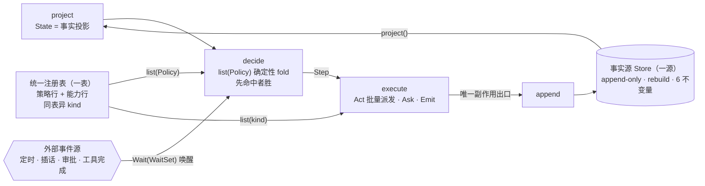
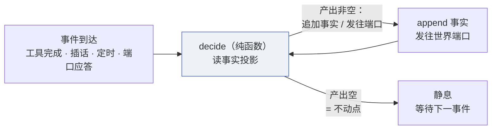

# PL-014 · 单环一表收敛方案

> 把 session 插件的控制面收敛为**一个单环 + 一张统一注册表 + 一个事实源**，
> 词汇全部取自 [PL-012-高阶智能体平台v2](012-高阶智能体平台v2.md) 已冻结的概念——本方案不是新架构，
> 是 v2 在控制面上的第一段落地路径。
>
> **一句话方案**：一轮的生命周期 = `loop { project → decide → execute → append }`，
> 策略和能力是同一张表的两种行，插件边界就是表上的一行。
>
> 修订记录：v2 草案——经 [SC-014-深度研究与报告](../002-scene/014-深度研究与报告.md)…[SC-017-定时任务与自动巡检](../002-scene/017-定时任务与自动巡检.md)
> 四类真实应用场景交叉验证（§7），形状从「两表」收敛为「一表」，
> 并回灌三个机制发现（§7.F1–F3）。
>
> 修订 v3：吸收更高一级抽象——不动点语义与注册即事实定为**终点坐标**（§2.1），
> 步骤 1 增「事件批序」显式产出（§5）、步骤 4 增收尾注（§5）、新增 §9 高阶演变。
> **施工六步不变**：终点坐标是语义重述，不是新迁移路径。

## §0 本文的可调整性：形状是裁决，路径是数据

本文经反复讨论成型，但它**不是不可更改的教条**。改动的门槛按对象分两层：

- **目标形状**（§2 一环一表一源、§2.1 终点坐标、§3 的 Step 词汇、§4 四条机制、§8 不动清单）
  是**裁决**——要改走 ADR，不在实现里绕过去。
- **施工路径**（§5 六步的切分、顺序、每步范围，以及判据落在哪一格）是**数据**——施工中发现
  更合理的走法（某步的前置其实不存在、某个死分支牵出比预想更长的退役链、某条熔断线在现实里
  根本不会命中），**就地改本文对应小节并写明理由**，不硬走一条已经知道走不通的路。

改动算不算「偏离」由三件事判，不由「是否与本文一致」判：①它仍属哪个迁移步（目标不变）；
②§6 判据与门禁是否仍全绿（**判据不降、红线不豁免**）；③偏离有没有留下记录（本文小节，
必要时一条 ADR 或一条 T）。硬约束只有一条方向：不许拿「方案就是这么写的」去掩护一个走不通的
形状，也不许拿「现实不需要」去跳过一条目标面的裁决。

已发生的实例：步骤 5a 删 `close_turn` 死分支时牵出 `context_compact` 工具与 55% 水位提醒的
**整条退役链**——工具在 v2 从未注入 ⇒ 提醒指向空处 ⇒ 开关是死配置，三者一并退役，裁决见
[ADR-072](../010-adr/072.md)；步骤 3 落地的 `policy.nudge` 行由此作废（§5 注）。这不改目标形状，
只是把「v1 外壳」的边界画得比 §5 那一行字更准。

## §1 与既有方案的关系

- [PL-012-高阶智能体平台v2](012-高阶智能体平台v2.md) 是目标架构与标尺：本方案每一步都映射到它的冻结面
  （Store 原语 / Actor 三模式 / Capability 封闭集 / 机制表守恒 / 事件网格），
  不引入任何新机制键。
- 「循环收敛为一次折叠 + 一张策略表」（形状 A）是本方案的**子集**：
  本方案在其上补齐能力统一分派、插件边界、第五个 Step 值与落地判据（§4–§6）。
- 与 [PL-006-分步实施计划](006-分步实施计划.md) 的关系：本方案的六个步骤（§5）登记为迁移批次，
  顺序在其批次轴下排布。
- **动机与急迫性依据**：五个结构性问题及其数字（两代执行器并存 / 控制面与数据面差一代 /
  参数隧道四结构体 / 一个机制实例化四族 trait / session 占全仓 41% 拆不动）
  登记在 [T-165-控制面收敛](../009-task/165-控制面收敛.md)，本文不复述——本文只回答「收敛成什么形状、怎么施工」。

### 与 v2 冻结面的逐项校验

| 本方案词汇 | v2 现成词汇 | 白拿的机制 |
|---|---|---|
| `Step = decide(State)` | Actor（pattern = Decider） | 模式三值、能力七值封顶 |
| 表内预算档 | `budget_ms` 四档 ZST 令牌（PL-001 §4.1） | 反射档在类型上拿不到 LLM 客户端 |
| `State = fold(事实)` | Store 的 projection | 投影签名约束是编译期强制 |
| 加行 = 注册 | 机制表 10 键守恒 | `新增机制键 = 0` 是 CI 断言不是愿望 |
| Step 序列回放 | L1 确定性（v2 已明确放弃 L2） | 承诺口径与 PL-001 §11 一致 |
| `drive()` 收敛语义 | 纯函数 decide 的不动点迭代 | L1 回放从「承诺」变成「定义」（§2.1） |

## §2 目标形状：一环 · 一表 · 一源



- **单环**：全系统唯一的控制面循环，替代现网 7 步 + 6 阶段 + 4 收口点的
  四层嵌套（`run_chat_loop_task → run_chat_loop → execute_turn → run_with_tools`）。
- **一表**：策略行与能力行同表异 kind（§4 机制 2）——不是两张表，
  插件注册只有一个入口。
- **一源**：`State` 是 Store 的投影，**不允许第二份状态表示**——
  治双写漂移，并使 decide 表成为事件网格第一个机制级读侧消费者（§6 判据 5）。

### 2.1 终点坐标：一函数 · 一日志 · 一端口

单环和统一表还有一个更抽象的等价形式，作为本方案的**终点语义**（不是新的施工路径）：

```text
agent = fixpoint(decide) over (事实日志 × 世界端口)

decide : (事实投影 × 事件) → [要追加的事实 | 要发往世界的意图]*
驱动   = 每个事件到达后，迭代 decide 直到不再产出任何东西
```



- **`drive()` 是不动点迭代的工程写法**，不是独立机制。回放 = 重放事件序列、
  逐事件重算不动点、比对事实日志——L1 确定性从「承诺」变成「定义」。
- **`Wait` 在终点折叠**：等待不是一种步骤，是端口开启时的默认状态；
  in-flight 集合本来就是事实（派发格 / 租约格），投影看得见。
  迁移期（§3）`Wait` 显式存在，是为了让审批 / 打断过网格比对。
- **注册即事实**：策略行与能力行落为事实日志里的注册事实——安装 = append、
  卸载 = 墓碑，`Registry` trait 随之消失，core 形状再降一格；
  内建行是代码常量（bootstrap），用户行是事实覆盖，配置可回放可 diff。
- **到此为止**：再压只有一条路——把端口也塞进日志（「一切皆事件源」），
  会劣化审批与流式的延迟语义，负收益，否决（§9.1）。

### 2.2 体系接口唯一化：能力如何了解上下文（2026-10-19 立为形状）

§2.1 的终点语义不只是环的算法形式，它就是**能力与引擎之间的接口本体**。由此得到本节的
唯一判据：**同一条需要只允许一种取得方式**——两条路径不是"灵活"，而是必然漂移的两个真源，
第三个入口随后就到（现网的 `history`/`range` 二分、12 处自取磁盘、`PathBuf` 跨墙交付，
是同一条判据被破三次后留下的三摊账）。

**两型能力，同一个 ctx**。能力若**被调度**（绝大多数），契约随调用上下文递进来即可——
它收的是**值**（事实的投影或快照、待落的事事实值）；能力若**主动发起流程**（心跳、自主触发、
子会话派工、审批恢复），它需要的是一个**主动口与协议**，而这个协议仓里已经有了：
「往一个可路由地址发一次带类型化 ctx 的请求」——`plugin/route`（能力地址）与
VDFS（资源地址）是它的两条地址空间，**不是两个协议**。所以两型不是两条路：
它们是同一个 ctx 的两种内容（值 / 那个唯一主动口的引用）。

**本方案的先例不是新发明的**：`symbio_core/vdfs/mod.rs` 已把范式写死——
「**core 只暴露纯接口**（`VdfsProvider` trait + 域类型），存储实现在 `providers/vdfs_service`，
线上形状与访问层在插件内部——与 `llm/model_provider` 的组织方式一致」。
按这把尺逐格检查，**事实轨是全仓唯一没照这个范式走的机制格**：core 同时导出了抽象
（`Store` 三法）与一份磁盘实现（`WalStore`：JSONL 布局、旁挂 `.lock` 写者令牌、归档段、
`v2-events.wal` 文件名）。能力之所以"能"绑定存储细节，不是纪律松动，是**机制层把它递到了
能力手里**。因此下面的归属是这把尺的推论，不是一项新决定。

**五类需要的唯一取得方式**（穷举，逐类给契约与呈现形态）：

| 需要 | 唯一方式 | 呈现形态 | 谁持有口 |
|---|---|---|---|
| A 读本会话事实 | 引擎在调用点递**投影值 / 快照值** | `Vec<Event>` 或具名投影产出 | 引擎 |
| B 落事实 | 能力交**待落事实值**，由引擎落；引擎自己落走端口写半 | `Event` 值 + `append` | 引擎 |
| C 让一轮发生 | 往该会话的地址写一条**触发事实**（触发即事实） | route / VDFS write + 同步回包 | 能力持**主动口引用**（经 ctx） |
| D 对外作用 | 世界端口（`Exec*` 四口） | 其结果必须落为事实 | 能力（它本就是端口的实现方） |
| E 声明性上下文 | `keys` 域类型化 ctx 键 | 值（装配告知或事实投影）；键不得承载第二份状态 | — |

**三条推论**：

1. **一抽象**：事实轨的机制层词汇 = 信封（`Event` / `Seq` / `Entity` / `Verb`）+ `Store`
   三法（`append` / `range` / `head`），**方法数不变**。读法必须归一：`range(from)` 定为
   「从 `from` 起的全部事实，含被取代前缀，按 seq 序」；今天 `range`（live 窗口）与
   `history`（含归档）的二分是**布局泄漏进抽象**——消费者得先知道"这条会话归档过没有"
   才知道该调哪一个（`message_events.rs` 里「用 `history()` 而非 `range()`」那段注释
   就是它留下的疤）。窗口是消费方按 `Seq`/`Budget` 自己切的事，live 段/归档段是实现内部的事
   ⇒ `history` 从公开 API 消失，三格 0 变。
2. **一持有规则**：**端口只在引擎手里，能力面 0 个口、0 条路径、0 个具体 store 类型**。
   兑现方式是把实现请出机制层：`WalStore` 一族（布局 / 锁 / 归档 / 文件名）落
   `plugins/session/store/`，可见性收到 `pub(in crate::plugins::session)`，core 根导出不再含
   WAL 词汇 ⇒ 违约**编译不过**，不需要任何人（包括本文件）再提醒一次。`Store` 端口与
   `EventStore`（内存参考实现）留在 core——前者是抽象，后者不含任何布局；
   `ephemeral` 会话因此不再是特例分支，而是换一次端口实现，`io.rs` 的豁免位随之消失。
3. **一写者**：端口由会话存储层**构造一次**、按值分发 ⇒ 进程内第二个 RW 持令牌者的形态
   不存在。T-055 的寄存机器（`PARKED` / `drain_parked` / `PARK_CAP`，占 `message_events`
   近半体量）不是被规约掉的，是随根因消失而**退成跨进程兜底**；每写点重放整份 WAL 的 IO
   放大同时消失。

**迁移义务**（旧形态一律切到本节形状，不许双轨并存）：

| 现存量 | 今天的模式 | 归宿 |
|---|---|---|
| 能力自取磁盘 12 文件（`skill_events` / `task_events` / `memory_events` / `worker_progress` / `breaker` / `elimination` / `stats` / `rebuild` / `inbox` / `autonomous` / `message_events` / `derived_facts`） | `session_dir` → `join(V2_WAL_FILE)` → `open*` | A/B：值注入 + 单一落格口 |
| `range` / `history` 二分 | 两种读法，选哪个取决于布局知识 | 推论 1 语义归一（逐点复核，见下） |
| `TurnHost` 随派发包交 `PathBuf`（[ADR-082](../010-adr/082.md "ADR-082") 施工改判②） | 名字消了、存储模式跨墙 | **作废**：改交付已构造的端口对象（`Arc<dyn Store<Event = Event>>`） |
| P5 写侧「运行态经 `emit_session_state` 自己开 WAL 落格」（[ADR-083](../010-adr/083.md "ADR-083") §5.1） | 又一个自取写点 | **作废**：P5 是本节契约的第一个新客户 |
| 闭族「事实轨 = core 的 WAL 类型」（ADR-083 §4 第 1 项） | 把实现的导出面当成了通货 | **重编**：分类成立，取值改为核心抽象（端口 + 信封 + 投影）与会话实现分离 |
| `autonomous` / `inbox` 直接落触发格再起轮 | 主动发起走了落格旁路 | C：一律经地址面（§5 步 6 触发半原裁决不变） |
| `ActiveSessionState` 四格 / `messages.json` / Registry 行 / 配置 | 各有独立状态面 | 一源：投影缓存或事实覆盖（§2 既有裁决，不因本节改动） |

**判据**（全部落在既有棘轮与编译边界上，零新增机制）：

1. 编译边界：`rg "WalStore|EventWalStore|\.history\(\)" symbio/src --glob '!plugins/session/**'` = 0，
   且 core 根导出无 WAL 词汇。
2. grep 台账：能力文件点名单内 `session_dir` / `V2_WAL_FILE` / `open_readonly` = 0
   （P2/P3/P4 同口径，形态稳定后升为门禁断言）。
3. CS-001 三格 18/56/18 不动、`Store` 方法数不变、**allow 行 0**；C-001/C-003 导出面只降。
4. 进程内唯一 RW 句柄：单测证「两个写者共享同一句柄 ⇒ 不走寄存路径」。
5. 行为：`range` 语义归一的**逐点复核表**——非测试调用点实测 **11 处**：10 处
   `range(Seq::new(0))`（`turn_exec` 884/1054/1167、`turn_runner` 941、`store/mod` 548、
   `task_events` 299、`skill_events` 210、`memory_events` 454、`worker_progress` 198）
   + 1 处真窗口 `range(Seq::new(conation_seq))`（`transcript/autonomous` 208，归一后**不变**）。
   每处要么证明「含被取代前缀」不影响其判据，要么改按 `Seq` 显式切窗。
   ⚠️ **复核已定的一条**：`turn_exec` 的轮号折叠（`count_user_messages`，1815）**今天是对的**
   ——归档把被取代的轮次移出 live 段，而快照载荷带着轮次水位 `turns`，轮号 = 水位 + live 段计数
   （两段相加，1805–1814 的文档就是这条不变量）。所以 `range`/`history` 二分**不是活缺陷**，
   它是布局泄漏进抽象；但归一后 `range(0)` 会带上归档前缀 ⇒ 该处必须改成「只数 live 段」的
   显式窗口**或**去掉水位那一段，两者取其一，**双算会让轮号跳过 ⇒ `u-{turn}` 幂等键失配**。
   测试基线 1753 不降；§6 判据 6 行为清单逐项不变。

**刀序**（替换 §5 步 6 注里的 ②'P5 排期）：**P6 体系接口唯一化**（推论 1–3 落地 + 迁移表前四行）
→ **P5 运行态归源**（P6 契约的第一个客户）→ **6b-③ 成片搬家**（落格半 = 注入已构造端口对象）
→ **6b-④ 守卫**。P6 是 §2「不允许第二份状态表示」与 §6 判据 5 在**接口面**的孪生判据：
接口面也不允许第二种取得方式。

## §3 Step：五个值，只携带引用

> 五个值是**迁移期接口**（步骤 1–5 的比对单位）；终点形态下 `Wait` 折叠为
> 端口默认态（§2.1）。迁移期显式保留，是因为审批 / 打断 / 恢复是行为面
> 最难钉住的部分，显式值才有过比对的对象。

```rust
enum Step {
    Ask(PromptRef),     // 要模型（Reasoner Actor）
    Act(Capsule),       // 要能力集合（一次可派发多项，见 F1）
    Emit(Fact),         // 只写事实（append，唯一副作用出口）
    Wait(WaitSet),      // 静息：等待一组外部事件（工具完成 / 审批 / 插话 / 定时）
    Halt(Reason),       // 结束（可恢复原因 → 复用现有 resume 机制）
}
```

**五值承重性**（删任何一个都表达不了现网）：`Wait` 是**外生信息唯一进环通道**——
定时器没有事实可派生（排程是事实，「未到期」是墙钟），删了它时间要么进 decide
（破纯度）要么轮询（劣化）；`Emit` 被 decide 纯度强制（纯函数不能自写）；
`Act` 集合值是并发事实（F1）；`Halt` 承载可恢复终止。**一处诚实的非极小点**：
`Ask` 严格说是 `Act(Model 行)` 的特例——保留独立值是为了把预算档 ZST 闸在
类型上，是工程取舍不是逻辑必然；`RowKind::Model` 已在，未来若证明合并更简，
路径是开通的。

硬规则（字母是引用柄，供 §5 等处引用；新增规则追加在尾）：

a. **Step 只携带事实引用（id），不携带数据**——执行器从 Store 取数。
   推论一：参数隧道死透（现网 `TurnState`(19 字段) → `TurnInputs` → `ExecTurn` →
   `TurnInput`(17 字段) → `TurnRunner` 五处声明，收敛为投影一处）；
   推论二：Step 可序列化，**L1 回放 = 重放 Step 序列对投影**，无需重执行工具；
   推论三：整轮决策日志可 diff（oracle 的基础）。
b. **副作用唯一出口是 `append`**——单写者不变量保持。现网 `TurnState` 约 19 字段中
   约一半是「读侧填、轮末收束入格」的双写簿记，副作用直落事实后**自动死亡**
   （终止守卫不是簿记，不适用本条，单独见 f）。
c. **`Wait` 不能省，且等待的是集合不是单项**。异步工具在途（一次响应可带多个工具调用 ⇒
   等待的是集合不是单项）、审批门
   （`WaitingUserAction`）、`ask_user`、定时唤醒（§7.F3）都是静息态；
   `Wait(WaitSet)` 复用现有 resume 机制，零新机制。
d. **投影成本不随会话长度增长**。`rebuild` 是为恢复设计的纯函数，不是热路径；
   环内用增量投影 `project_since(seq)` + 缓存 fold——每轮成本正比于事件增量，
   不做全量重折叠。属读侧实现细节，零新机制键。
e. **失败是事实，不是新的 Step 值**。现网 768 行内的失败分支（fallback / aborted /
   denied / truncated）统一 = `Emit(失败事实)`（persist_failure 单出口）→
   由 decide 按策略行裁决重试 / 中止 / 熔断——**不加第六值 `Fail`**，
   五值封闭；「分支 → Step × 事实」映射表是步骤 1 的显式产出（§5）。
f. **终止性由事实承载，不靠「模型总会停」**。现网环的终止面由三样东西构成：
   续写上界 `MAX_CONTINUE_ROUNDS` + `continuation_count`（**上界**，`turn.rs:9` /
   `state.rs:200`）、`nudged_this_request`（**一次性闸**，`state.rs:202`）、
   `tool_calls.is_empty()`（**正常出口**，不是守卫）——前两样是上界与闸，
   规则 b 的「自动死亡」不适用于它们。新形状里：重试消耗预算档令牌
   （attempt 计数入事实），预算耗尽 decide **必须**产出 `Halt`；`drive` 另加
   兜底上界 `MAX_STEPS_PER_DRIVE = 64`（现网参照 `MAX_TOOL_CALLS_PER_RESPONSE
   = 32`，`stream.rs:40`，+ 等量 Ask/Emit 余量），单次事件驱动内 Step 数超
   上界即 `Halt`（开发档 panic）；`Halt(Reason)` 必须落一条事实——否则重启后
   无从知道为何停。这是把现网计数器的保证搬进新形状，「失败 → 策略行重试」
   才不会造出不收敛环，零新机制。
g. **None 是异常，不是出口**（步骤 2 建表起生效）。「drive 完结」本身是一个
   判断——由策略行发出 `Halt(Done)`（T-156 步骤 1 抽出的 `final_answer` 正是
   这个判断）；decide 返回 None 意味着「drive 未完却无规则可发」——**规则缺口**。
   None 必须落一条 `Halt(NoRule)` 事实，开发档 panic、生产档告警；静默 quiesce
   与规则缺口是同一失效形状，必须可见。回放由此区分三种终止：策略 `Halt` /
   自然完结 `Halt(Done)` / 兜底上界 `Halt(BudgetExhausted)`。

流式帧不走 Step：保持现有 sink 直通（`emit_message_patch` 必须同时触发
VDFS change 通知与 `StreamEvent::Update` 的契约不动），`Emit` 只管事实。

## §4 机制定义

### 机制 1：单环驱动器

```rust
async fn drive(store: &Store, registry: &Registry) {
    loop {
        let state = store.project();                    // 唯一状态来源
        match decide(&state, registry.list(Policy)) {   // 先命中者胜
            Some(step) => execute(step, registry, store).await,
            None => halt(NoRule),                       // 规则 g：None 是缺口，不是出口
        }
    }
}
```

decide 本身不是机制，是 `list(Policy)` 上的确定性 fold——没有独立的策略表 trait，
也就没有第二套注册口。drive 的收敛语义 = **不动点迭代**：每个事件到达后
迭代 decide 至不再产出；「环」是不动点迭代的工程写法（终点语义见 §2.1），
迁移期保持 loop 形式是为了与现网行为逐格比对。

**可靠性前提（本方案唯一依赖的交换律）**：fixpoint 之所以能与「事件中途到达」
复合，是因为一切变化——工具完成、插话、定时、审批——都在下一次 `project`
之前经 `append` 落为事实：**append 是唯一的交换点**，任何不经 `append` 改
State 的路径都非法。L1 回放的确定性由三件事合成：decide 纯度 + `(prio, name)`
全序 + 事件批序入日志——缺一回放即不成立。

### 机制 2：统一注册表（**一个行形状 + 两个目录**，按消费方分）

> **2026-10-19 措辞修正（[ADR-089](../010-adr/089.md)）**：本节标题原为「策略行 +
> 能力行，同表异 kind」。实测落地是**两张表**（core 的 `CapabilityRow` / loop 的
> `Row`），且这个结果是对的：策略行的判据依赖 loop 私有的 `LoopState`，它的消费方
> 只有一个（环），拉进共享地址要么把 `LoopState` 写进 core、要么泛型传染，两条都
> 撞 C-003。**「一表」应读作「一个行形状 + 两个目录」**——形状与裁决规则只有一份
> （`{name, prio, 纯判据}`、`(prio,name)` 全序、先命中者胜），不是一个 Rust 类型。
> `RowKind::Policy` 已作为死变体从 `CapabilityRowKind` 删除。

> **2026-10-20 形状补一维（[ADR-093](../010-adr/093.md)）**：策略目录的行形状从
> `{name, prio, 纯判据}` 变为 `{name, site, prio, 纯判据}`——`site` 是决策点的闭集
> 枚举（`turn_head` / `round_boundary` / `compress` / `turn_prepare` / `reflex`）。
> 因此 **`prio` 的作用域是格内，不是全局**：跨格同号不冲突，同格重号仍然启动期
> fail-fast；`decide` 只扫本格（此前五格各扫五行，4/5 是陪跑）；返回值从
> `Option<Hit>` 分为 `Hit` / `Declined` / `Unmanned`，把 §3 规则 g 的「规则缺口
> 必须可见」落到直线代码上。配套把 `LoopState` 从「十字段并集 + `blank()` 填假值」
> 改为**按格分形的枚举**——「行只读本格字段」因此从「要人读五个构造器确认」变成
> 编译错误。三条都是 §5 步骤 3「记忆 / 技能拆两行」的前置：没有 `site` 时，同格
> 加第二行要先从全局 `prio` 空间里挤一个号。
> 该维度随 `drive` 落地消失（格由投影位置隐含，见 ADR-093「后续」）。

下面保留的是**当初对形状的推导**（为什么三方法、为什么内部 enum、为什么顺序是数据）——
它们仍然成立，只有「同一个 struct 装两种行」这一句被撤。

```rust
enum RowKind { Policy, Tool, Model, Prompt, Mount, Option, Configurable }
struct Row { name: String, prio: u32, kind: RowKind, schema: Schema, run: Run, effects: Effects }
enum Run { Policy(fn(&State) -> Option<Step>), Cap(Arc<dyn Capability>) }  // 内部 enum，外部投影
trait Registry { put / get / list(kind) }   // 16 + 2 + 2 方法 fat visitor → 3 方法
```

- **`RowKind` 封闭集是七值**（**现状六值**：`Policy` 已删，见上方措辞修正）：`Configurable` 随 4e 入表的裁决见 [ADR-071](../010-adr/071.md)（原六值草图的偏离，
  按 §8 登记义务走 ADR）。

- **`Run::Cap` 本批就是现网的 `Arc<dyn Capability>`**——`Capability::execute(args, &ExecEnv, ctx)`
  已经是有副作用执行的完整形态，19 个工具无一需要 `&Store`。`Exec / &Store / Vec<Fact>`
  这一组签名推迟到**第一个真正需要 Store 的能力族**出现时再引入，届时 `&Store` 只能是
  per-session 的 `EventWalStore`。在一个搬迁批次里夹带"执行体自己产 Fact"，等于同时改
  19 个实现的职责与网格写方纪律，会把步骤 1 的 300 行熔断线直接顶穿。
  完整裁决见 [AR-025](../005-arch/025-capability-registry.md "AR-025-capability-registry") §4。
- **纯度不因一表降级**：`list(Policy)` 返回的是纯 `fn(&State) -> Option<Step>`
  （现状：策略行由 loop 自己的 `Registry` 持有，臂已收成闭集枚举，见 [ADR-088](../010-adr/088.md)）
  投影，不是 `Row`——「纯决策」与「有副作用执行」的区分**保在编译期**，
  内部 enum 的 match 只发生在注册边界一次。decide 的纯度是 L1 回放、
  Step 可序列化、整轮可 diff 三条判据的承重墙，不允许降级为运行期检查。
- **顺序是数据**：先命中者胜按 `(prio, name)` 升序，`prio` 由注册事实携带——
  顺序进日志、可 diff、可回放，不绑注册插入顺序（与 §2.1 配置可回放一致）。
  同一决策点 `prio` 冲突 = **启动期 fail-fast**，不静默兜底——字母序不是裁决者。
- **Policy 行**：`run` 即纯 decide，先命中者胜；
  `effects` 携带预算档，直接用 PL-001 §4.1 的三档 ZST 令牌
  （`RuleOnly` / `ClassifyOnly` / `FullModel`——那节列的是四档**时延**，
  自主档与深度档共用 `FullModel`，故令牌只有三只）——反射档在类型上
  拿不到 LLM 客户端，事前闸门零成本继承。
- **能力行**：`run` 即执行体；`effects` 携带 risk / approval / retention——
  审批判据从同一张表读，不再是 register 时的包装器。
- 三个现网约束：**动态行**（MCP 桥接工具运行期 put/remove）、
  **作用域投影**（VDFS 挂载的按作用域裁剪 = `list(kind, scope)` 过滤参数，
  不是第二条链路）、**有状态能力句柄**（F2）。

### 机制 3：有状态能力的租约化（来自 §7.F2）

浏览器会话、长连接 MCP 这类**跨 Step 存活的能力实例**：实例登记为事实
（租约格），`Act` 引用实例 id；能力行本身保持无状态，状态进事实源——
断点恢复（SC-005）对有状态能力白拿生效。崩溃恢复对在途 `Act` 取
**at-least-once**：日志有派发格而无结果格 → 重发；幂等性由能力行 `effects`
声明，非幂等能力在恢复点请求人工确认。

### 机制 4：唤醒源（来自 §7.F3）

`Wait(WaitSet)` 的输入是**事件**：工具完成、审批通过、用户插话、定时触发
统一为事件源。环内不感知时间与触发器——定时/巡检（SC-017）与插话（SC-007）
对环是同一种东西：一条让 Wait 出静息的事件。触发器是环外机制
（现有 consume / EventBus 承接），不是新机制键。在途 `Act` 的取消
（插话 / 熔断）是第二类端口写：事件落事实 + execute 的取消侧信道——合法，
但必须在「事件批序」（步骤 1 产出）里定义，否则取消时序成为隐式步骤。

## §5 落地六步（每步一个 git 提交，回退单位 = git 提交）

| 步 | 内容 | 钉子 | 熔断线 |
|---|---|---|---|
| 0 | 基线快照：core 三格数字 + LLM 工具清单 + `session/stats` 四列 | 现有棘轮脚本 | — |
| 1 | 把 `run_with_tools` 内循环（768 行单函数，`turn_runner.rs` 696–1463）抽成 Step 循环，纯内部重构；**显式产出四件**：「事件批序 + 静息判定」（批序不定，步骤 3 双跑比对会因时序抖动假红）、「768 行 → Step × 事实」映射表（缺图则 300 行熔断被突破的原因不是抽象错而是缺图）、失败分支映射（§3 规则 e）、增量投影 `project_since(seq)` + 缓存（§3 规则 d） | e2e t27 全量 + 全量/增量投影随机切点对拍（逐格相等，比 e2e 早发现问题） | **结构性改动** >300 行 = 抽象错了，退回；语义产出物（映射表 / 批序定义 / 对拍测试）不计入改动量 |
| 2 | 建 Registry（先只挂 Policy 行）。第一批两行：`policy.classify`（轮首判决，步骤 2b）+ `policy.report`（轮边界汇报，`chat_loop::round_report_hook`）。**`compose` 不单独成行**——它不做判断（只把判决翻成话），按表的语义它是**能力行**，随步骤 4 迁入 | oracle = 事实网格 + Step 序列逐格比对；策略已有独立开关可逐个验证 | 任何一格漂移即停 |
| 3 | 反射 / 压缩 / 记忆 / 技能四策略移入表。落地四行：`policy.compress`（自动压缩开关）、`policy.nudge`（水位提醒三条件）、`policy.recall`（记忆召回 + 技能路由 + 任务段，共用「本轮首次 ∧ 有落盘目录」）、`policy.reflex`（`resume_allowed ∧ has_match`）。**记忆与技能拆成两行推迟**：区分它们的量（「本轮已召回否」）只在 drive 循环里自然存在 | 同上 | 同上 |
| 4 | 能力四族一族一族迁入同一张表（Tool → Model → Prompt → Mount/Option），**就地变形**而非新写 trait，旧 visitor 每迁一族删一批方法（trait 数不变、方法数每步净降） | 工具清单逐条比对 + schema 导出比对；`SubAgentVisitor` 是第二实现方，漏改 = 子智能体工具集静默退空 | 某族塞不进 RowKind 封闭集 → 停下修模型，不加封闭集之外的口子（4e 触发过一次，裁决见 [ADR-071](../010-adr/071.md)）；`pub trait` 若升 ⇒ 抽象错了 |
| 5 | 删 v1 外壳：`close_turn` 死分支（代码内文档已承认生产不可达）、TurnState 簿记字段随副作用直落自动清零 | e2e + 网格 | — |
| 6 | 切插件：session → `session`(存储+生命周期) / `loop`(驱动器) / `memory` / `compact` / `tools`。**这一行的切片清单归 [ADR-075](../010-adr/075.md) 裁决**：`memory` 与 `compact` 不在切出之列（前者是会话数据本身；后者的边界曾随三层淡化是否接入而变动，[ADR-078](../010-adr/078.md) 裁决退役后已定），且判据「可独立卸载」要求先立三条前置——P1 常驻任务可取消、P2 `Arc<SessionPlugin>` 换窄手柄、P3 跨片调用走表或端口；第一批切**心跳片**。施工登记 [T-167](../009-task/167-会话插件切分.md "T-167-会话插件切分")；驱动器片的前置触点收敛由 [ADR-081](../010-adr/081.md "ADR-081") 立为 **P4「四个不」**（不解存储 / 不绕开口柄构造 / 不把存储内部对象拿回家 / 不自拼存储侧多步编排），批次 6 随之分 6a 收敛与 6b 切片；6b 的切片形状（成片落独立插件 `loop`、触发走地址面、服务走 core 端口、分四刀）归 [ADR-082](../010-adr/082.md "ADR-082") 裁决 | 每个插件可独立卸载且系统仍完整（v2 切分不得妥协的原判据）——**今天的形态是「停用只是从名册里划掉一个名字」**：两条常驻循环没有取消位、`Plugin::stop` 全仓只有 `composite` 实现，所以此判据要靠 P1 才第一次可验 | 步骤 1–5 未完成前**禁止**启动此步，否则只是搬家 |

步骤 4 的施工图、三问裁决（`ctx` 句柄 / `Vec<Fact>` 边界 / `&Store` 归属）与迁移账见
[AR-025-能力统一注册表](../005-arch/025-capability-registry.md "AR-025-capability-registry")。

顺序关键点：步骤 2 第一批选 classify / report——它们各自对应一个**真实的判断**
（「这句话该派活吗」「干了一会儿了该说一句吗」），且都已有独立开关可逐个验证，
失败面最小。**`compose` 不进策略表**：它不做判断（`chat_loop/compose.rs` 的模块
文档自己写了「`compose` 不做判决」），按 §4 的语义它是**能力行**，随步骤 4 迁入
`Run::Cap`。把它硬塞成策略行只能造出一条恒真的判据——那是给表加装饰，不是加能力。

步骤 4 收尾注（对应 §2.1 终点坐标）：四族迁毕后可把注册行**落为事实**
（注册即事实）——安装 = append 注册事实、卸载 = 墓碑事实，
`Registry` trait 随之消失，core 三格再降一格；内建行是代码常量（bootstrap），
用户行是事实覆盖，配置可回放可 diff。此为收尾小步，不单独立批。

步骤 5 落地注（5a、5b-1、5b-2 已落地）：5a = 删 `close_turn` 的工具分发死分支 + 它牵出的
`context_compact` / nudge / `enable_compact_tool` 退役链（裁决见 [ADR-072](../010-adr/072.md)，
它同时作废步骤 3 的 `policy.nudge` 行）；5b-1 = `TurnState` 的轮内簿记随「副作用直落自动死亡」
这条推论清零，闸门的「等工具齐」一并退场（裁决见 [ADR-073](../010-adr/073.md)）；
5b-2 = 仍有活读方的那一格（恒 0 的 `tool_rounds` 喂着软上限、fade 判定与抽干分支三处）
连同两个旋钮的归属一起裁决：改名成它实际能数的 `request_round`、软上限整条退役、
抽干点搬到批次边界并把「抽到补充 ⇒ 静默时钟归零」做成入参（裁决见
[ADR-074](../010-adr/074.md)；fade 三层与 `fade_activate_rounds` 一并退役，归 [ADR-078](../010-adr/078.md)）。
**5a 没有把「删死分支」做成一行删除**，因为它牵动的是一条完整的能力路径——这正是 §0 说的
「路径是数据」：形状不变，边界按现实重画。

步骤 6 施工路径修正注（2026-10-19，裁决见 [ADR-083](../010-adr/083.md "ADR-083")）：6b 原案
「服务 = 两个 core 端口 trait」（[ADR-082](../010-adr/082.md "ADR-082") 裁决二）经从本文 §2/§6
出发的自上而下复核**废除**——候选端口面 ≈41 法，其主体是宿主未归源运行态（`is_working` /
结局 / 告警）的逐字段镜像，落 core 即把「一源」裁决的欠账永久化为机制面（trait 数 18→20 回吐
§6 判据 2 的达成线、方法成员 56→~97 违背判据 3「只降不升」）。补立切片前置 **P5
「运行态归源」**：轮生命周期落事实轨、`ActiveSessionState` 降格为投影缓存；切片跨墙通货
**闭族**在既有 core 机制词汇（事实轨 + 世界端口 + 地址面 + 纯值记录），新增 trait 0。
**目标形状一字不动**（一环一表一源、卸载判据、`loop` 独立片），改的是刀序：②端口 → ②'P5，
③搬家以 ②' 验收为前置。这同样不是新机制——它是 §2「不允许第二份状态表示」与 ADR-049
「读侧逐点切事实源」在生命周期段的补课。

**刀序再排一次（2026-10-19，形状见 §2.2）**：②'P5 之前插入 **P6「体系接口唯一化」**——
§2.2 查出运行态/事实面的混乱不是缺纪律，是机制层把磁盘实现（`WalStore` 一族）和能力端口
一起递给了消费者，于是 P5 的写侧、6b-③ 的跨墙交付都各自长出了一种私有取法。P6 按仓内
既有范式（`vdfs` / `llm` 的「core 只暴露纯接口」）把实现请出机制层，A/B 两面归一为值注入 +
单一落格口；**P5 改在 P6 的契约上施工**，③ 的落格半改交付已构造的端口对象。目标形状仍
一字不动。

**6b-③ 切片契约（2026-10-19，裁决见 [ADR-086](../010-adr/086.md "ADR-086")）**：P6 与 P5 收口后，
6b-③ 不再需要为跨墙另立端口——`TurnDispatch` 随 fork 后的 ctx 进程内交付（`WIRE=false`），
`TurnSpec` 只含纯值（目录预计算、14 个配置标量），两向触发都走 VDFS 动作面
（session→loop 的 `loop/<sid>` 与 loop→session 的 `session/<sid>/_run/<op>`），写动作在 session
侧沿用唯一落库回包实现并发帧、返回权威副本。新增 trait 0、机制键 0，目标形状与卸载判据不变；
刀序 **③a 词表上移 → ③b 动作面 → ③c 搬家 → ③d 触发改地址面 → ③e 收口**，单批一提交。

## §6 判据（全部用现成棘轮表达，零新增机制）

1. 加一个能力 = **1 行注册**；加一个策略 = **1 个策略文件 + 1 行注册**——驱动器零改动。
2. core 收集口：CapabilityVisitor（16 方法）+ OptionVisitor（2）+ ConfigurableVisitor（2）
   → **1 个 Registry trait（3 方法）**。trait 数 20 → ≤19（16 + 2 + 2 方法的收敛账见
   [AR-025](../005-arch/025-capability-registry.md "AR-025-capability-registry") §2）。
   **已达成**：4e 收敛至 1 trait 3 方法（trait 数实测 18）、4f 改名落位（账见
   [T-165](../009-task/165-控制面收敛.md "T-165-控制面收敛")）。
3. core 三格（`pub trait` / `fn` / 默认体）：**只降不升**（CS-001 原样；收窄不需批准）。
4. `新增机制键 = 0`（v2 守恒律 CI 原样）。
5. **`State` 的输入必须是现有 Store 的投影**——防第三处双写复发；
   同时 decide 成为事件网格的第一个机制级读侧消费者，
   闭合「网格只写不读、七个投影零生产消费者」的验收缺口。
6. **行为判据**：审批 / `ask_user` / 心跳 / 流式中断 / 并发排队（SC-004 的 t15/t32/t34）
   在折叠后行为逐项不变；**事件批序与静息判定是显式定义**（步骤 1 产出，非隐含约定）——
   e2e 最难自动钉住的面，显式清单而不是隐含在「网格一致」里。

## §7 场景交叉验证

**方法**：以 [SC-000-场景汇总](../002-scene/README.md) 汇总的 17 个场景（SC-001…017）为验证集，
逐个问三个问题——它的 Job 在单环上是什么形状？靠哪一行 / 哪个 Step 承载？
有没有把机制逼到说不出话的地方？说不出话的地方回灌 §3–§4（F1–F3），不另立机制。

### 17 场景 × 单环形状

| 场景 | 单环上的形状 | 结论 |
|---|---|---|
| SC-001 最小闭环 | `Ask → Emit → Halt` | ✅ 直接承载 |
| SC-002 工具调用与产物 | `Act → Emit(产物引用)`；产物进 VDFS 不进日志 | ✅ |
| SC-003 多步任务与返工 | 事实即历史，`rebuild` 出返工点投影 | ✅ 折叠天然给返工 |
| SC-004 并发调度与租约 | 排队/单写者在环外 orchestrator；环内 `Act` 集合 + `Wait(WaitSet)` | ✅ **F1** |
| SC-005 长会话与断点恢复 | `Halt(Resume)` + 事实持久；有状态能力走租约格（F2） | ✅ |
| SC-006 长期记忆与语义检索 | 策略行：召回 / 编码 / 巩固各一行 | ✅ |
| SC-007 插话与实时打断 | 插话 = 事件源注入 `Wait`，decide 读到后改道 | ✅ **F3** |
| SC-008 多主体与对等承诺 | `agent_run` 是能力行；子会话 = 独立单环 + 自己的 Store | ✅ 嵌套环，不是嵌套步骤 |
| SC-009 外部执行与熔断 | 能力行 `effects`（risk/approval）→ `Wait(审批)` → 熔断 = Halt(Reason) | ✅ |
| SC-010 个人认知体系注入 | Prompt 行 + 记忆策略行 | ✅ |
| SC-011 技能编译与自我改进 | 技能 = 策略行 / 能力行的持久化产物；第二次更快 = 命中策略行短路 | ✅ |
| SC-012 自主层与长期目标 | 无用户输入时事件源唤醒 decide，自主发起 = 无 Ask 前置的 Act | ✅ **F3** |
| SC-013 多智能体社会 | 组织 = 多个单环 + 共享事实格；承诺 = 租约格（F2 的推广） | ✅ |
| SC-014 深度研究与报告 | 多轮 `Ask ⇄ Act` 长循环；预算档闸门限深；报告 = 产物 + 引用事实 | ✅ |
| SC-015 浏览器自动化操作 | 能力实例跨 Step 存活：租约格 + `Act` 引用实例 id | ✅ **F2** |
| SC-016 数据与文件分析 | 大产物走 VDFS 引用（append-only 体积约束）；执行器 = 动态能力行 | ✅ |
| SC-017 定时任务与自动巡检 | 定时 = 事件源唤醒 `Wait`；触发历史 = 触发事实；静默 = 策略行 | ✅ **F3** |

### 交叉验证回灌的三个机制发现

- **F1（SC-004 / SC-016）`Act` 是集合不是单项**：一次响应带多个工具调用、整批等齐才续
  （现网 `DispatchPort` 批分发，审批中断时本批剩余有意留空），四值单发 Step 表达不了；
  `Act(Capsule)` 一次派发多项、
  `Wait(WaitSet)` 等待集合完成。排队与单写者留在环外 orchestrator（t15/t32/t34 钉住）。
- **F2（SC-015 / SC-005 / SC-013）有状态能力必须租约化**：浏览器登录态这类
  跨 Step 存活的状态，若藏在能力行内部，断点恢复对它失效；实例登记为事实
  （租约格），能力行保持无状态——SC-005 / SC-013 的恢复与承诺语义白拿。
- **F3（SC-017 / SC-007 / SC-012）时间与插话是同一种东西**：无人值守场景
  证明「没有用户请求的一轮」必须存在，唤醒只能来自环外事件源；
  定时、插话、工具完成统一为事件，环内零时间感知——否则单环要为定时
  开特例口子，恰是本方案要消灭的形状。

### 验证结论

17/17 场景可被「一环一表一源」承载，无需第六个 Step 值、无需新机制键；
三处「说不出话」均已回灌为 §3–§4 的机制约束。**剩余风险集中在行为面
（§6 判据 6），不在表达面**——即方案能说出每个场景怎么做，
但审批 / 打断 / 恢复的手感要靠迁移中的行为清单逐项钉住。

## §8 风险与不动清单

**风险**

- `turn_runner` 是唯一被 e2e 全量钉住的资产——**只收敛，不重写**。
- `Wait / Halt(Resume)` 是行为面最大变数，步骤 2 就要让它过网格比对，不留到最后。
- 步骤 1 的**结构性改动**若超 300 行 = 抽象错了，立即退回；语义产出物（映射表 /
  批序定义 / 对拍测试）不计入改动量——判据误伤比判据缺失更难查（§5 步 1）。
- **规则遮蔽**：先命中者胜可让高 `prio` 宽 guard 的规则饿死低优先规则——
  同 `prio` fail-fast 抓不到（不同 prio + 重叠 guard 才是遮蔽），规则重叠判定
  不可判定；兜底 = 回放 diff + 新行先灰度观察。接受为已知风险，不修。
- **在途 `Act` 的崩溃语义**是 at-least-once（§4 机制 3）：非幂等能力在恢复点
  需要人工确认——这是恢复体验的代价，不是缺陷。

**明确不动**

- home / hook / setting / event_bus 等 200–1,100 行小插件，不值得动。
- model 由 session 直连 `execute_turn` 是 ADR 已决，不为对称改路由。
- `broadcast_frame` → EventBus 的子会话中继、`emit_message_patch` 双通知等活契约原样保留。

**登记义务**

- 本方案落地时在 [PL-006-分步实施计划](006-分步实施计划.md) 的批次轴上登记对应批次；
- 步骤 4 的 `RowKind` 封闭集偏离已发生并裁决入档（[ADR-071](../010-adr/071.md)，+`Configurable`）；
  后续再偏离封闭集，照旧是同一条纪律——那是 ADR，不是实现细节；
- SC-014…017 的用户判据现均为缺口（挂 [T-011](../009-task/011.md)），按 SC-000 §4 规则销缺口时只改对应 SC 单文档。

## §9 高阶演变（记录性，不进本方案施工范围）

### 9.1 终点之后的边界

「一函数 · 一日志 · 一端口」（§2.1）是不可再约形态：decide 纯函数 +
两个副作用边界（端口、append）。再压只有「把端口塞进日志（一切皆事件源）」一条路，
会劣化审批与流式的延迟语义——**否决，理由登记于此，不再重开**。

### 9.2 差距驱动的后续批次（前置 = 步骤 1–5 落地）

以 [RE-008-行业能力前沿参照](../006-ref/008-行业能力前沿参照.md) 的差距对照为输入。每条都过 J1 检验
（已有机制的新取值，零新增机制键），落地时按 [PL-006-分步实施计划](006-分步实施计划.md)
批次轴另立任务，逐条销对应 SC 的 T-011 缺口：

| 后续能力 | 承载方式（表上加行） | 对应差距轴 / 场景 |
|---|---|---|
| 验证器循环（rubric 评分器 + 返工至达标） | Reasoner 策略行（独立上下文）+ 预算档 ZST 令牌 | 行业分水岭；SC-003 / SC-005 可靠性前提 |
| 沙箱化执行 | 能力行（provider）+ 有状态能力租约格（F2） | 桌面形态最大安全缺口；SC-009 / SC-016 |
| 浏览器 / computer-use | 动态能力行 + 证据走 VDFS | SC-015（整轴缺失） |
| 深度研究（串行版） | 多轮 `Ask ⇄ Act` 长循环 + 预算档限深 | SC-014 |
| evals 飞轮（trace → 数据集 → 回归评测） | 事实网格读侧投影消费者 | 度量缺口（PL-010） |
| METR 式可靠性口径 | `task_duration` / `success_rate` 投影参数 | 长时程度量（S10 读侧归约先例） |
| A2A 互操作 / SKILL.md 生态 | provider 层适配 | SC-008 / SC-011 互操作 |

**顺序建议**：evals 飞轮先于新能力——先有度量，后续每加一行才有判据可钉，
否则浏览器 / 沙箱上线即盲飞。验证器循环次之（它是长任务可靠性的共同前提），
沙箱第三（它是三条新轴的共同基础设施）。

### 9.3 与 v2 的最终对齐

本方案（步骤 1–5 + 注册即事实收尾）完成后，控制面即 [PL-012-高阶智能体平台v2](012-高阶智能体平台v2.md) §0
「1 原语 + 1 签名约束 + 1 使用者概念 + 3 不变量 + N 行参数数据」在 session 域的完全体；
§9.2 的每一条后续能力都是 v2 的「新能力 = 占格子」，架构改动 = 0——
这正是 T-120 阶梯判据（J1）在控制面收敛后的延续。
